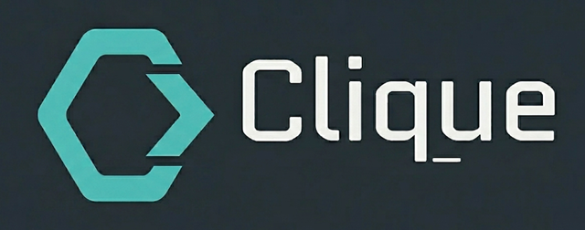

<div align="center"></div>

# Clique
> An exclusive group. A winning leader.

**Clique** is a modular extension for [Click](https://click.palletsprojects.com/), designed to enable seamless integration and
provide practical features for advanced CLI development.

Clique follows the DRY (Don't Repeat Yourself) principle,
allowing you to define a command once, clone it,
and reuse it across multiple groups with granular control over its execution and output.
At its core is the Leader architecture, which orchestrates commands, progress tracking, and message formatting.


[](https://www.python.org/downloads/)
[](LICENSE)

## Table of Contents

- [Key Features](#key-features)
- [Installation](#installation)
- [Usage Example](#usage-example)
- [License](#license)

## Key Features
[TBD]

## Installation

### From source
**Using pip:**
```bash
pip install git+https://github.com/rc2215/clique.git
```

**Using Poetry:**
```bash
poetry add git+https://github.com/rc2215/clique.git
```

## Usage Example

```python
import logging
from time import sleep
from typing import Final

import click

from clique import CliqueGroup, Leader, LogSettings, clone_command, pass_leader
from clique.progress_notification import progress_generator

_logger = logging.getLogger(__name__)

LOG_SETTINGS: Final[LogSettings] = {'default_level': logging.DEBUG}
TEMPLATES: Final[dict[str, str]] = {'task_completed': '$time. Everything you need is here.'}


def get_package() -> str:
    for eta in progress_generator(range(2215), 'package_implementation'):
        sleep(eta)
    return 'Clique'


@click.command(name='cmd')
@click.option('-q', '--question', help='Help me help you', required=True)
@pass_leader
def command(leader: Leader, question: str) -> None:
    """
    Answer some of your questions about Clique
    """
    with leader.progress_notification('package_implementation'):
        get_package()
    leader.send_message(key='task_completed', values={'time': 'Now'})

    leader.send_message(f'Check the docs for the answer to your question: "{question}"')


new_command = clone_command(command, 'clone', overrides={'question': 'How do I clone a cmd?'})


@click.group(cls=CliqueGroup, log_settings=LOG_SETTINGS, message_templates=TEMPLATES)
def group() -> None:
    _logger.warning('Colorized logs have just started...')


group.add_command(command, name='demo', aliases=['ex', 'am', 'ple'])
group.add_command(new_command, help_text='')
```

## License

This project is licensed under the MIT License. See the [LICENSE](LICENSE) file for details.

---
